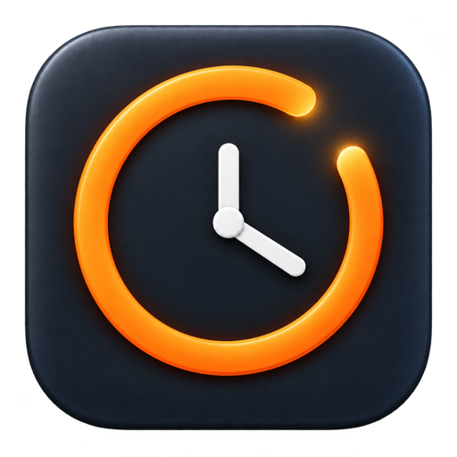

# BreakBar

<p align="center">
  
</p>

[](https://github.com/allenhutchison/breakbar/actions/workflows/ci.yml)
[](LICENSE)

BreakBar is a Mac-first menu-bar countdown that makes regular breaks hard to ignore. It works without external hardware; optional accessories can mirror the current state and send the same typed commands as the Mac UI.

## Download

Signed and notarized builds are published on the [BreakBar releases page](https://github.com/allenhutchison/breakbar/releases/latest). BreakBar checks that release channel automatically, verifies downloaded archives with a dedicated EdDSA signature before extraction, and installs updates when it is ready to relaunch. You can also check immediately from the circular-arrows button in the menu-bar popover or from Settings. BreakBar currently supports Apple Silicon Macs running macOS 14 or later.

The project website is published at [allenhutchison.github.io/breakbar](https://allenhutchison.github.io/breakbar/).

## Run the app

The current slice requires macOS 14 or newer and Swift 6.

```sh
make run
```

For a one-minute focus cycle, 15-second warning, and 20-second minimum break:

```sh
make demo
```

On first launch, a setup assistant explains the focus/warning/break loop and offers notification access, Calendar selection, live-meeting options and launch at login. Every integration is optional, and setup can be skipped or run again from Settings. Notification permission is requested only after choosing **Enable Notifications** in setup or Settings.

The app lives quietly in the menu bar and starts its countdown when you are active. The warning posts one notification when permitted and always plays a sound. At zero, start a break from the full-screen prompt, or choose **5 more minutes** in normal mode (**15 more seconds** in demo mode). This option is available once per focus cycle and stays used after a restart. **Pause reminders** provides a Mac-side escape from every overlay. Starting a break launches the screensaver when available; returning cannot end the break before its minimum duration.

Open **Settings** to change the focus interval, warning duration, and minimum break. Timing preferences persist across restarts. **Restore timing defaults** returns to a 55-minute focus cycle, 5-minute warning, and 5-minute minimum break. Demo timing remains accelerated. Automatic away detection uses the minimum break duration, so a qualifying absence starts a fresh countdown on return.

BUSY Bar support is optional and disabled by default. Connect the device over USB, then enable **Use BUSY Bar accessory** in **Settings → BUSY Bar**. The default USB address is `http://10.0.4.20`; it can be replaced with another explicit HTTP or HTTPS device address. BreakBar mirrors its current state to a self-clearing display element, reconnects automatically, and maps the BUSY Bar START button to the action currently offered by the Mac. Every input is revision-checked before it enters the same persisted command path as the Mac UI. Wi-Fi discovery and credential storage are not part of this USB-first integration.

BreakBar starts break reminders automatically when you are active at your Mac. There is no clock-in, clock-out, or time classification. **Pause reminders** stops reminders until you explicitly choose **Resume reminders**, including after restarting the app. A short absence preserves the current countdown; after enough time away to satisfy the minimum break, returning starts a fresh focus cycle. A deliberate break still enforces its minimum duration.

Connect and select calendars in **Settings** to plan around meetings and travel. BreakBar listens for calendar changes, refreshes every 15 seconds, and refreshes after wake or activation. Once EventKit supplies a deleted, moved, or shortened meeting, its old window no longer suppresses breaks. An overdue break receives a full warning before enforcement. An ongoing detected call continues to suppress breaks until the call ends. Calendar refresh depends on the calendar provider syncing changes to macOS.

An event whose title contains `Travel`, `Commute`, or `Drive` starts a travel chain; a physical event location marks an offsite meeting, and an ordinary meeting between outbound and return travel blocks is treated as offsite too. BreakBar shows a five-minute `Leave` countdown with a notification and sound, then a `TIME TO GO` overlay at departure. Break reminders pause through the connected offsite chain and resume when you are active after it ends. Calendar titles are used for classification but are never stored in timer state.

BreakBar saves its current timer for restart recovery and no longer records work sessions, activity categories, or a daily timeline. The Obsidian integration and history reporting have been removed. Existing Markdown notes remain untouched. History recorded by earlier versions is preserved and frozen when you first run this version. Settings no longer includes history export or deletion controls.

Open **Diagnostics** from the information button in the menu-bar popover to inspect timer, scheduling, integration, database, and BUSY Bar health. **Copy Diagnostics** omits calendar titles and identifiers, call application identifiers, file paths, device addresses, credentials, and raw errors.

## Verify

```sh
make test
make build
```

Run the macOS Settings/privacy and automatic pause/resume acceptance tests in an isolated app
bundle and temporary database:

```sh
make test-ui
```

The UI-test profile uses the distinct `app.breakbar.mac.uitest` bundle identity,
does not start live integrations or update checks, and never reads normal or
demo history.

With a BUSY Bar connected over USB, its opt-in acceptance test verifies the
real API version, WebSocket state stream, forwarded input loopback, and physical
buttons, selector, and wheel:

```sh
make test-busybar-hardware
```

The test waits up to 90 seconds for the physical controls and remains skipped
during normal and CI test runs. `BREAKBAR_BUSYBAR_URL` can override the default
USB address; `BREAKBAR_BUSYBAR_API_TOKEN` supplies a local access token without
placing it in source or command output.

## Contributing

Issues and feature discussions are welcome. BreakBar is maintainer-directed:
do not open a pull request unless the maintainer has explicitly approved the
implementation in a linked issue. Unsolicited pull requests will likely be
closed without review; independent changes should be maintained in a fork.
Read [CONTRIBUTING.md](CONTRIBUTING.md) for the full policy and development
workflow. Report security and privacy vulnerabilities privately according to
[SECURITY.md](SECURITY.md).

## Release

Public builds are created by the `Release` GitHub Actions workflow. It builds the release configuration, embeds and signs Sparkle's updater helpers with the Developer ID Application certificate, enables the hardened runtime, submits the app to Apple for notarization, staples the resulting ticket, and publishes `BreakBar.zip`, its SHA-256 checksum, and an EdDSA-signed `appcast.xml` to GitHub Releases.

The release workflow requires the repository secrets documented in [the release guidelines](.claude/guidelines/release.md). It intentionally does not publish an unsigned fallback.

The Makefile selects the installed Xcode beta because this machine’s currently selected standalone Command Line Tools contain a compiler/SDK mismatch. Override `DEVELOPER_DIR` when a stable matching Xcode is selected.

## Architecture

- `BreakBarCore` contains the deterministic state machine, policy, presentation model, and accessory protocol. It has no UI or hardware dependency.
- `BreakBarBusyBar` contains the optional BUSY Bar HTTP/WebSocket transport, namespaced self-clearing display operations, API compatibility checks, official-protobuf input decoding, and reconnecting accessory adapter. `BreakBarApp` owns the opt-in lifecycle and revision-checks actions before routing them to the Mac state machine, so the Mac-only path stays complete.
- `BreakBarPersistence` owns the recoverable state snapshot and compatibility access to the legacy SQLite ledger. Timer transitions commit there before the UI publishes them.
- `BreakBarApp` is the always-available Mac presentation/input implementation and integrates Sparkle for signed updates.

Normal and demo runs use separate databases under BreakBar’s Application Support directory, so accelerated cycles never alter the normal timer. Existing `state.json` state is imported once when the normal SQLite database is first created and retained as a recovery artifact.

The broader product design is in [planning/BreakBar V1 Design.md](planning/BreakBar%20V1%20Design.md).

## License

BreakBar is available under the [MIT License](LICENSE). Third-party components
retain their own licenses.
